# SQLite-Datenmodell

Das Datenmodell besteht aus bewusst nur **10 Tabellen** (5 im Kern-Schema [001_init.sql](server/src/migrations/001_init.sql), plus `import_templates` in [002_import_templates.sql](server/src/migrations/002_import_templates.sql), `report_account_configs` in [004_report_account_configs.sql](server/src/migrations/004_report_account_configs.sql) `import_exclusions` in [006_import_exclusions.sql](server/src/migrations/006_import_exclusions.sql) sowie `mobile_devices` und `mobile_entries` in [007_mobile.sql](server/src/migrations/007_mobile.sql)). Kategorien sind keine eigene Entität, sondern normale Konten vom Typ `income`/`expense` im Kontenrahmen — das spart eine Tabelle gegenüber klassischen Finanz-Apps.

## ER-Diagramm

```mermaid
erDiagram
    ACCOUNTS {
        integer id PK
        text name
        text type "asset | liability | equity | income | expense"
        integer parent_id FK "NULL bei Wurzelknoten"
        integer is_active "0/1"
    }
    PAYEES {
        integer id PK
        text name "UNIQUE"
    }
    TRANSACTIONS {
        integer id PK
        text date "YYYY-MM-DD"
        text description
        integer payee_id FK "nullable"
    }
    POSTINGS {
        integer id PK
        integer transaction_id FK
        integer account_id FK
        integer amount_cents "signiert, Summe pro Transaktion = 0"
    }
    RECURRING_TEMPLATES {
        integer id PK
        text name
        integer payee_id FK "nullable"
        integer from_account_id FK
        integer to_account_id FK
        integer amount_cents
        text interval "weekly | monthly | yearly"
        integer interval_day
        text start_date
        text end_date "nullable"
        integer active
        text last_booked_date "nullable"
    }
    IMPORT_TEMPLATES {
        integer id PK
        text name "UNIQUE"
        text delimiter
        integer has_header "0/1"
        integer skip_rows "führende Zeilen vor Header/Daten, Default 0"
        text mapping "JSON: {date,amount,description?,payee?} je {index,header}"
        integer default_account_id FK "nullable"
        text skip_patterns "JSON-Array [{pattern,field}], Default '[]'"
    }
    IMPORT_EXCLUSIONS {
        integer id PK
        integer account_id FK "Ziel-Konto der CSV, ON DELETE CASCADE"
        text date "ISO"
        integer amount_cents "vorzeichenbehaftet wie in der CSV"
        text description "normalisiert: klein, Whitespace zusammengefasst"
    }
    MOBILE_DEVICES {
        integer id PK
        text name "Anzeigename, z. B. iPhone Thomas"
        integer account_id FK "festes Bargeldkonto des Geräts"
        text token_hash "UNIQUE, SHA-256 des Geräte-Tokens, NULL vor Kopplung/nach Widerruf"
        text enroll_code_hash "SHA-256 des Kopplungscodes, NULL nach Verbrauch"
        text enroll_expires_at "UTC, 10 Min nach Erzeugung"
        text created_at
        text last_used_at "nullable"
        text revoked_at "nullable"
    }
    MOBILE_ENTRIES {
        integer id PK
        integer device_id FK "ON DELETE CASCADE"
        integer transaction_id FK "ON DELETE CASCADE"
        text client_id "vom Gerät erzeugte ID, UNIQUE je Gerät"
        text created_at
    }
    REPORT_ACCOUNT_CONFIGS {
        integer id PK
        text name "UNIQUE"
        text account_ids "JSON-Array gewählter Konto-IDs, z. B. [2,6,3]"
    }

    ACCOUNTS ||--o{ ACCOUNTS       : "parent_id (Kontenrahmen-Baum)"
    ACCOUNTS ||--o{ POSTINGS       : "account_id"
    TRANSACTIONS ||--o{ POSTINGS   : "transaction_id"
    PAYEES ||--o{ TRANSACTIONS     : "payee_id"
    PAYEES ||--o{ RECURRING_TEMPLATES : "payee_id"
    ACCOUNTS ||--o{ RECURRING_TEMPLATES : "from_account_id"
    ACCOUNTS ||--o{ RECURRING_TEMPLATES : "to_account_id"
    ACCOUNTS ||--o{ IMPORT_TEMPLATES : "default_account_id"
    ACCOUNTS ||--o{ IMPORT_EXCLUSIONS : "account_id"
```

## Tabellen im Detail

### `accounts` — Kontenrahmen
Selbstreferenzierender Baum (`parent_id`) für die Hierarchie Aktiva/Passiva/Eigenkapital/Erträge/Aufwendungen — beliebig tief verschachtelbar (kein Tiefenlimit im Schema), z. B. Aufwendungen > Freizeit & Hobby > Urlaube & Trips > Wochenendreisen. Blätter unter `income`/`expense` fungieren zugleich als **Kategorien**; Auswertungen (`/reports/by-category`) rollen Beträge über beliebig viele Ebenen hoch. `is_active = 0` deaktiviert ein Konto ohne es zu löschen (Historie bleibt erhalten).

### `payees` — Zahlungsempfänger
Freie, eindeutige Liste (`UNIQUE(name)`), wird bei neuer Buchung per Autocomplete wiederverwendet oder automatisch angelegt (`findOrCreatePayee`).

### `transactions` — Buchungen
Der eigentliche Beleg: Datum, Beschreibung, optional ein Zahlungsempfänger. Enthält selbst keine Beträge — die stehen in `postings`.

### `postings` — Buchungszeilen
Herzstück der doppelten Buchhaltung: mindestens 2 Zeilen pro Transaktion, `amount_cents` ist **vorzeichenbehaftet** (positiv = Geld fließt ins Konto, negativ = Geld fließt heraus), und die Summe aller Zeilen einer Transaktion muss exakt 0 ergeben. Das ersetzt klassische Soll/Haben-Spalten durch ein einziges Vorzeichen.

### `recurring_templates` — Wiederkehrende Zahlungen
Vorlagen für Extrapolation (Prognose) und "Jetzt buchen". Fix auf **zwei** Konten (`from`/`to`) begrenzt — für Aufteilungen (z. B. Zins/Tilgung bei einer Hypothek) reicht das nicht, dafür muss weiterhin manuell mit Splits gebucht werden. `last_booked_date` verhindert, dass ein bereits verbuchtes Vorkommen erneut als "fällig" auftaucht.

### `import_templates` — CSV-Import-Vorlagen
Speichert Spalten-Zuordnung, Trennzeichen und Ziel-Konto für wiederkehrend gleich strukturierte CSV-Exporte (z. B. der monatliche Kreditkarten-Export derselben Bank). Das Mapping liegt als **JSON-Text** in `mapping` statt als eigene Spalten je Feld — hält die Tabelle schlank, analog zu `postings` als "flexible" Tabelle im Kernschema. Jedes gemappte Feld (`date`, `amount`, optional `description`/`payee`) trägt sowohl den Spalten-**Index** als auch den **Header-Text** zum Speicherzeitpunkt: beim Anwenden auf eine neue Datei wird zuerst per Header-Text gesucht (übersteht leicht andere Spaltenreihenfolge bei künftigen Exporten), erst bei fehlendem Treffer auf den Index zurückgefallen. `default_account_id` ist optional und wird beim Anwenden als Ziel-Konto vorausgefüllt. `skip_rows` (Default 0, seit [003_import_template_skip_rows.sql](server/src/migrations/003_import_template_skip_rows.sql)) überspringt eine feste Anzahl führender Zeilen vor Trennzeichen-Erkennung und Parsing — nötig bei Bank-Exports mit Metadaten-Zeilen vor der echten Überschrift (z. B. MLP Banking AG: Überschrift erst ab Zeile 15, also `skip_rows = 14`). `skip_patterns` (Default `'[]'`, seit [005_import_template_skip_patterns.sql](server/src/migrations/005_import_template_skip_patterns.sql)) speichert wie `mapping` ein JSON-Array — hier von `{pattern, field}`-Objekten (`field` ∈ `description|payee|both`): Zeilen, deren Beschreibung und/oder Zahlungsempfänger auf einen dieser Regex passt, werden im Import-Vorschau als "ignoriert" markiert und nie gebucht. Praxisfall: Bargeldauszahlungen per Kreditkarte erscheinen sofort auf der Kreditkartenabrechnung, werden aber erst Tage später auf dem Girokonto tatsächlich abgebucht — mit einem Suchmuster lässt sich die verfrühte Zeile beim Kreditkarten-Import überspringen und stattdessen erst beim späteren Girokonto-Import buchen.

### `report_account_configs` — gespeicherte Kontenauswahl für Auswertungen
Speichert eine benannte Auswahl von Konto-IDs als **JSON-Array** in `account_ids` (analog zum flexiblen JSON-Text in `import_templates.mapping`). Genutzt von der Geldverwendungs-Auswertung (`/reports/money-usage`), um die Gruppe der liquiden Konten einmalig zusammenzustellen und später per Namen wiederzuverwenden — statt sie bei jedem Besuch neu anzuklicken. Bewusst generisch gehalten (`account_ids` ohne festen Bezug zu einem Report-Typ), damit die Tabelle bei künftigen Auswertungen mit Kontenauswahl wiederverwendbar bleibt.

### `import_exclusions` — dauerhaft ausgeschlossene Import-Zeilen
Merkt sich CSV-Zeilen, die beim Import bewusst **nicht** gebucht werden sollen (z. B. Kreditkarten-Bargeld, das erst später auf dem Girokonto gebucht wird), damit sie beim erneuten Import derselben Datei automatisch als "ausgeschlossen" erscheinen. Das generische CSV-Format hat keine Bank-Transaktions-ID, daher ist der Abgleich ein **Fingerabdruck** aus Ziel-Konto (`account_id`), Datum, Betrag und normalisierter Beschreibung (klein geschrieben, Whitespace zusammengefasst). Der Ausschluss gilt **pro Ziel-Konto**: dieselbe Zeile in einer Girokonto-CSV bleibt unberührt. Es gibt bewusst keine UNIQUE-Bedingung — zwei identische Zeilen am selben Tag werden als zwei Einträge gespeichert, und beim Abgleich wird pro Fingerabdruck nur so oft ausgeschlossen, wie Einträge existieren, sodass eine zweite, nicht ausgeschlossene Doppelzeile nicht mitverschluckt wird. Gespeichert wird die *ursprüngliche* CSV-Beschreibung, nicht ein im Import-Vorschau editierter Text.

### `mobile_devices` — gekoppelte iPhones
Ein Eintrag pro Gerät der mobilen Erfassung (siehe README, Abschnitt *iPhone-Erfassung*). `account_id` ist das **feste Bargeldkonto** des Geräts: Es wird bei der Kopplung gewählt und ist die einzige Gegenbuchung, die das Gerät erzeugen kann — die App kann es nie selbst bestimmen. Geheimnisse werden **nie im Klartext** gespeichert: `token_hash` und `enroll_code_hash` sind SHA-256-Hashes (Token und Code sind zufällig und lang genug, dass ein schneller Hash genügt; ein Passwort-Hash wie scrypt wäre hier nur Overhead). Lebenszyklus: *angelegt* (Kopplungscode gesetzt, `enroll_expires_at` = +10 Minuten) → *aktiv* (Code verbraucht, `token_hash` gesetzt) → *widerrufen* (`revoked_at` gesetzt, beide Hashes gelöscht, das Gerät bekommt sofort 401). Die Buchungen widerrufener Geräte bleiben erhalten.

### `mobile_entries` — vom Handy erfasste Buchungen
Verknüpft jede über die mobile Erfassung angelegte Buchung (`transaction_id`) mit dem Gerät. Dreifacher Zweck: **Duplikatschutz** — `UNIQUE(device_id, client_id)` macht das erneute Senden eines Warteschlangeneintrags (`client_id` wird auf dem Gerät erzeugt) idempotent; **Berechtigung** — „Rückgängig" ist nur für eigene Einträge des Geräts (und nur 24 Stunden lang) möglich, nicht für beliebige Buchungen; **Nachvollziehbarkeit** — woher eine Buchung stammt. `transactions` selbst bleibt unverändert. Beide Fremdschlüssel sind `ON DELETE CASCADE`: Löscht man eine Buchung in der Desktop-App oder entfernt ein Gerät, verschwindet nur die Verknüpfung, nie umgekehrt eine Buchung durch das Entfernen eines Geräts.

## Kernentscheidung: ein Vorzeichen statt Soll/Haben

Statt zwei Spalten (Soll/Haben) hat jede Buchungszeile nur `amount_cents`:

| Kontotyp | Beispiel | Zeichen bei Zunahme |
|---|---|---|
| Aktiva | Girokonto | positiv |
| Aufwendungen | Lebensmittel | positiv |
| Passiva | Kreditkarte | **negativ** |
| Erträge | Gehalt | **negativ** |
| Eigenkapital | Eröffnungsbilanz | negativ |

Das ist weiterhin echte doppelte Buchhaltung (jede Transaktion balanciert über ≥2 Konten auf 0), nur ohne die Soll/Haben-Terminologie. In Dashboard/Auswertungen wird das Vorzeichen für Erträge zur Anzeige umgedreht, damit Einnahmen dort positiv erscheinen.
